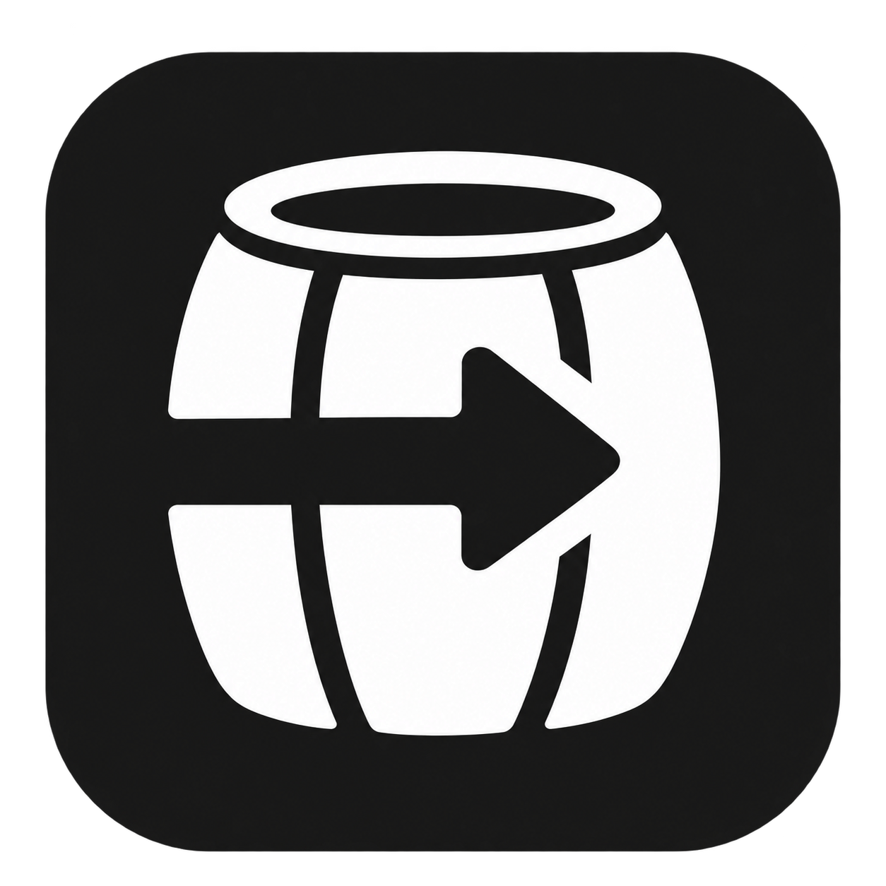

# Caskrun

**Windows apps, games and browser favorites in one native Mac collection.**

Caskrun is an independent, open-source launcher for **Apple Silicon Macs**, in active development. It manages Wine bottles, installs Windows stores and keeps their apps together in a native SwiftUI interface. It is not affiliated with CodeWeavers and includes no proprietary CrossOver application code or assets.

**Current development version: 0.2.0.** Source is public; the ready-built development app and DMG are local artifacts. There is no public signed binary release or active update feed yet.

## What you can do

- **Collect and launch.** Collection groups Windows apps and discovered Steam, Epic and GOG games into bottle folders. Original app icons stay compact; browser games use game pictures. Click to inspect, double-click to open.
- **Install stores or your own apps.** Discover includes Steam, Epic, GOG Galaxy, Battle.net, Ubisoft Connect, EA, itch.io and Rockstar. You can also run a local EXE/MSI or import an existing bottle. Installer, sign-in and gameplay results are tracked separately.
- **Keep control of a bottle.** Rename, duplicate, export, restore and recover deleted bottles. Inspect installed programs, open the C: drive, save launch arguments and use Wine's configuration tools. Running bottles offer Quit Apps and an explicit Force Quit when needed.
- **Choose graphics when needed.** Automatic uses conservative import evidence. The existing bottle inspector provides WineD3D, DXMT, DXVK, High Resolution and supported MSync controls; ordinary installation needs no Wine picker.
- **Play in your browser.** Discover has 26 reviewed game/collection links with pictures, per-game browser selection and local bookmarks. Some community ports require your own original game files. No commercial game content is bundled.
- **Use familiar Mac controls.** Native Dock names and artwork, menu-bar access, window reopen and text-editing controls. Closing Caskrun's window keeps its apps running; full Quit stops its owned Windows sessions. Browser tabs remain under your browser's control.
- **Keep data local.** Bottles, saves, browser preferences, artwork caches and raw logs stay on your Mac. Shareable diagnostics use a bounded allowlist. Git publication checks reject private paths, credentials, user data and build products.

The optional PS5 adapter accepts a user-provided local KytyPS5 engine and your own game files. Its app integration has fixture validation only. A separate AnyPS5/Wine experiment ran public PS5 DOOM homebrew; it is not retail-game support. See [PS5 scope](docs/EMULATION_RESEARCH.md) and [AnyPS5 results](docs/ANYPS5_WINE.md).

## Graphics in the current development engine

| Option | Available scope | Limits |
| --- | --- | --- |
| Automatic | Can select verified DXMT for supported x64 Direct3D 10/11 evidence, or hybrid DXVK for unmixed x86/x64 Direct3D 9 imports. | Mixed, unknown or incomplete evidence keeps WineD3D. Direct3D 12 is not selected automatically. |
| WineD3D | Existing compatibility fallback. | Its measured OpenGL path is not a modern Direct3D 11/12 replacement. |
| DXMT | Metal-based Direct3D 10/11; **experimental x64 Direct3D 12** with the reviewed V16 engine. | D3D12 is limited to FL11_1 / SM5_1; DXIL and several advanced pipelines are unsupported. Select DXMT explicitly to test it. |
| DXVK hybrid | Direct3D 9 plus Direct3D 10/11 through the bundled reviewed MoltenVK. | Vulkan feature limits affect individual titles. No Direct3D 12 through this path. |
| MSync | Bottle-scoped, opt-in synchronization. | Off by default; supported engine required. Game performance remains to be measured. |
| High Resolution | Optional Retina backing store and DPI controls. | DPI-unaware apps may remain upscaled; independent of renderer choice. |
| Apple D3DMetal | Native framework control passed; Wine integration is still under development. | Unavailable until the Wine factory/device/render gates pass. Apple's evaluation component is separately licensed and not published here. |

DXMT frame targets and MetalFX **spatial** output scaling are optional controls. They do not add DLSS, temporal reconstruction, ray tracing or frame generation. Existing saved graphics choices are preserved; changes require an idle bottle.

### What has actually been tested

- The hybrid DXVK path passed the original x86/x64 Direct3D 9 and 11 GPU matrix, including shaders/readback, Present, resize and recreation.
- DXMT's original x86/x64 Direct3D 10/11 tests cover rendering, window lifecycle and saved tuning. Its new x64 D3D12 path passed hardware clear, shader draw/readback and six presentation calls with resize and window recreation in an isolated development test.
- MSync passed 296 assertions across enabled/disabled, x86/x64 and WineD3D/DXMT combinations.
- A user confirmed that **R.E.P.O. launched and worked with DXMT** on the tested setup. Camp Forest Green's Steam-detection issue remains a recorded launcher-specific limitation.

API tests do not establish broad game compatibility, visible image quality or faster gameplay. Store installation, authentication, game launch and sustained play are separate checks. Anti-cheat, DRM, missing graphics features, media and publisher updates can prevent individual titles from working.

See [current backend evidence](docs/GRAPHICS_BACKEND_STATUS.md), [Direct3D 12 integration](docs/D3D12_EXPERIMENT.md), [launcher results](docs/LAUNCHER_VALIDATION.md) and [the next manual tests](docs/NEXT_MANUAL_TESTS.md).

The original [D3DMetal host-bridge experiments](runtime-patches/d3dmetal-integration-notes.md)
are kept as source and API probes. Preparing their private Wine candidate is a
manual development step. A successful adapter test does not enable Apple's
renderer in the installed engine.

## Build from source

Requires an Apple Silicon Mac, macOS 14+, Xcode command-line tools, Python 3 and Rust/Cargo with edition-2024 support. Add the ARM64 target if needed:

```sh
rustup target add aarch64-apple-darwin
./scripts/build.sh
open .build/Caskrun.app
```

The app and Core are ARM64. The independent x86/x64 Windows engine runs through Rosetta on Apple Silicon; Intel Macs are outside the target scope.

A plain source build does **not** bundle Wine. The Core can discover an independently obtained compatible runtime on `PATH`, or use `CASKRUN_WINE`. The reviewed DXMT/DXVK, synchronization and native app integrations require the matching complete Caskrun development runtime. A generic Wine installation does not provide those capabilities. See [runtime preparation](docs/LOCAL_WINE_RUNTIME.md) and [DXMT integration](docs/DXMT_APP_INTEGRATION.md).

### Local development app and DMG

Prepare the reviewed engine at `.build/native-text-wine-runtime-dev-v16/`. Runtime provenance, corresponding source and license notices must remain with it. Then:

```sh
mkdir -p .build/release-candidate
CASKRUN_PACKAGE_OUTPUT_DIR="$PWD/.build/release-candidate" ./scripts/package-dmg.sh
./scripts/publish-dev-dmg.sh .build/release-candidate
(cd dist && shasum -a 256 -c Caskrun-0.2.0-arm64-dev.dmg.sha256)
```

The scripts verify the exact approved runtime, nested signatures and disk image. They refuse to replace an app while its processes or engine files are in use. The local DMG is ad-hoc signed and not notarized for public distribution; `dist/`, runtime binaries and user data are excluded from Git. Binary publication needs its own privacy and runtime-license review.

Sparkle support is included for signed ready-built GitHub updates. **Check for Updates…** reports the absence of a configured public feed honestly. See [update delivery](docs/APP_UPDATES.md).

### Tests

```sh
cargo test --locked --manifest-path core/Cargo.toml -- --test-threads=1
python3 scripts/test_dxmt_d3d12_dev.py
python3 scripts/test_dxmt_d3d12_harness.py
python3 scripts/test_package_dxmt_d3d12.py
```

GPU harnesses require the reviewed runtime and original compiled probe fixtures; they create disposable owned bottles and verify mapped graphics libraries before rendering. They never use your real bottles. Keep raw test logs private. See the individual scripts and [manual checklist](docs/MANUAL_TEST_CHECKLIST.md) for scope.

## Project status and contributing

Caskrun is usable development software, with compatibility work ongoing. Priorities include more reliable stores, real-game validation, graphics coverage, media/controllers, clean-machine installation and signed releases. No performance advantage over other launchers is claimed.

Read [CONTRIBUTING.md](CONTRIBUTING.md), [feature gaps](docs/FEATURE_GAPS.md), [feature inventory](docs/FEATURES.md) and [SECURITY.md](SECURITY.md). The project name remains provisional pending a publication trademark check.

Caskrun's original app, Core and tooling are [MIT licensed](LICENSE). Wine/DXMT patches are LGPL-2.1-or-later; attributed AnyPS5 patches are GPL-2.0-only. Other components, data and artwork retain their own terms: see [third-party notices](THIRD_PARTY_NOTICES.md). No CrossOver application code, recipes, assets or extracted runtime is included.
